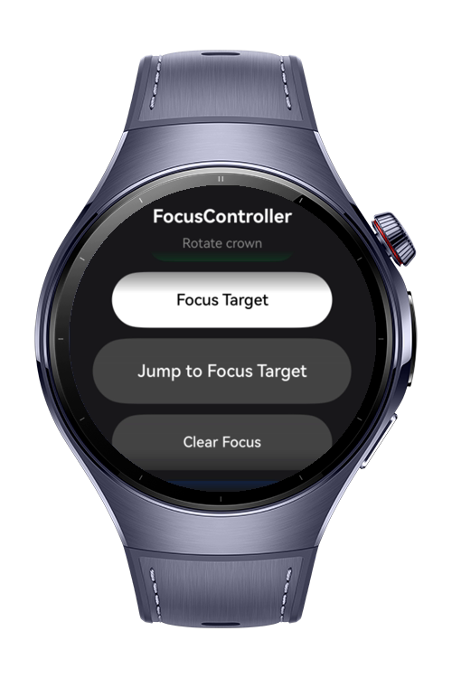
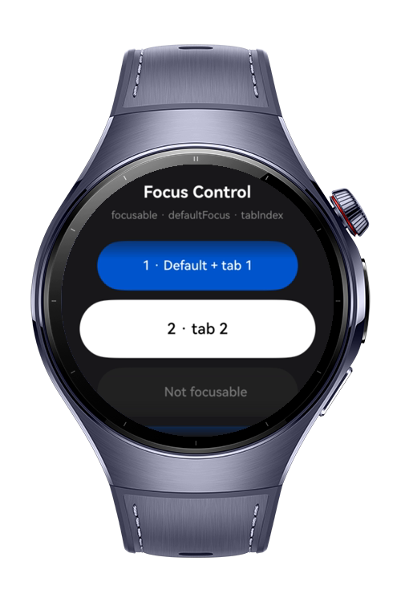
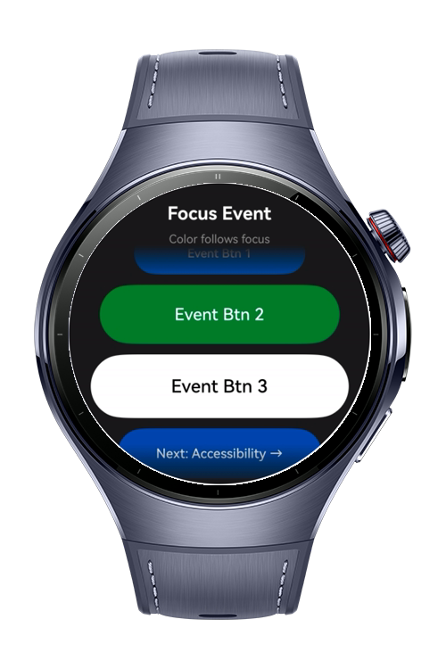
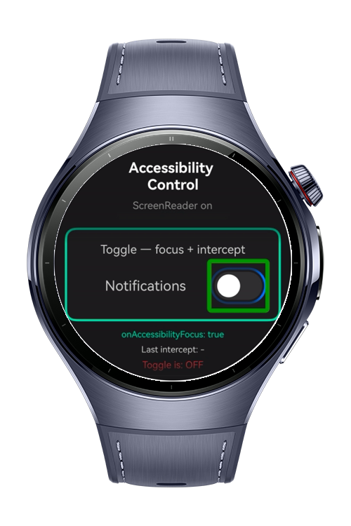

> **Note:** To access all shared projects, get information about environment setup, and view other guides, please visit [Explore-In-HMOS-Wearable Index](https://github.com/Explore-In-HMOS-Wearable/hmos-index).

# How to Build Focus Accessibility

How to Build Focus Accessibility is a HarmonyOS wearable codelab that demonstrates how to build a watch UI which is fully navigable with the Digital Crown, without any touch. It is aimed at users with motor impairments who rely on the crown and hardware buttons instead of tapping the screen. The app walks through five ArkUI focus and accessibility APIs in context, each on its own screen: programmatic focus control, focusable/default-focus/tab-index properties, focus-driven visual feedback, and accessibility control actions. Built around the circular `ArcList` component, the centered item always holds focus as the crown rotates, so every interactive element is reachable and clearly highlighted while the user simply turns the crown.

# Preview

<div>
  
  
  
  
</div>

# Use Cases

1. Touch-Free Navigation: Every interactive element is reachable using only the Digital Crown, so users who cannot tap reliably can still operate the whole app.

2. Programmatic Focus Control: The app moves focus to a specific element by ID (`requestFocus`) and resets focus to the root container (`clearFocus`) through explicit API calls rather than touch.

3. Visual Focus Feedback: As the crown rotates, the centered element gains focus and is highlighted, giving immediate, glanceable feedback about where the user is.

4. Accessibility Mode Support: With ScreenReader enabled, a toggle intercepts the click action to ask for confirmation before changing state, and the focused control is visually highlighted, helping prevent accidental activations.

# Tech Stack

- **Languages**: ArkTS
- **Frameworks**: HarmonyOS SDK 6.0.1 (API 20)
- **Tools**: DevEco Studio Vers 6.0.1 Release
- **Libraries**: @kit.ArkUI, @kit.BasicServicesKit

# Directory Structure
   ```
   entry/src/main/ets/
 ├── pages
 │   ├── Index.ets                  // Navigation host and route map
 │   ├── MainPage.ets               // FocusController demo (requestFocus / clearFocus / activate)
 │   ├── FocusControlPage.ets       // Focus Control demo (focusable / defaultFocus / tabIndex / focusBox / focusOnTouch)
 │   ├── EventPage.ets              // Focus Event demo (focus-driven color feedback)
 │   ├── AccessibilityPage.ets      // Accessibility Control Actions (onAccessibilityFocus / onAccessibilityActionIntercept) + Slider/Scroll actions
 ├── viewmodels
 │   ├── FocusListViewModel.ets     // Shared state and focus logic for the crown-driven pages
 │   ├── AccessibilityViewModel.ets // State and logic for the accessibility page
 ├── services
 │   ├── NavigationService.ets      // Singleton NavPathStack navigation
 ├── utils
 │   ├── FocusNavigatorUtil.ets     // requestFocus/clearFocus wrapped with focus error handling (150001/150002/150003)
   ```

# Constraints and Restrictions
## Supported Devices
- Huawei Watch 5

# License
**How to Build Focus Accessibility** is distributed under the terms of the MIT License
See the [LICENSE](./LICENSE) for more information.